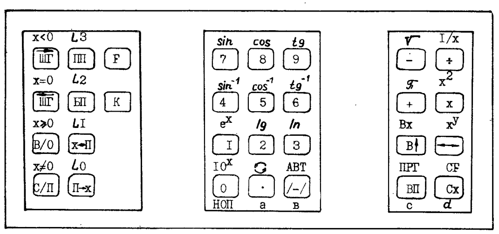

# Электроника МК-56 — Operating Manual (English translation)

An English translation of «Микрокалькулятор Электроника МК56. Техническое
описание и инструкция по эксплуатации», the factory technical description
and operating instructions. The scan of the original is in
[references/MK-56 inst.pdf](../../references/MK-56%20inst.pdf).

| Chapter | Original sections | Manual pages |
|---------|-------------------|--------------|
| [1. Purpose and specifications](01-purpose-and-specifications.md) | contents, §1, §2.1 | 1–8 |
| [2. Principle of operation](02-principle-of-operation.md) | §2.2, keyboard, Tables 2–3 | 8–19 |
| [3. Construction](03-construction.md) | §2.3 | 19–20 |
| [4. Safety and preparation](04-safety-and-preparation.md) | §3, §4 | 20 |
| [5. Automatic mode](05-automatic-mode.md) | §5 | 20–50 |
| [6. Programming mode](06-programming-mode.md) | §6.1–6.2, code table (Table 4) | 50–64 |
| [7. Jumps and indirect addressing](07-jumps-and-indirect-addressing.md) | §6.3 | 64–85 |
| [8. Example programs](08-example-programs.md) | §7 | 85–94 |
| [9. Maintenance and storage](09-maintenance-and-storage.md) | §8, §9 | 94–95 |
| [10. Functional test](10-functional-test.md) | Appendix | 96–100 |

## About this translation

- It translates what is printed and adds nothing. Section numbers follow the
  original, and each section gives its manual page as *(p. NN)*.
- Key names are kept as printed (`[В↑]`, `[П→x]`, `[С/П]`), with an English
  gloss the first time each appears in a chapter.
- Displayed values keep the decimal comma: `12,56637`, `5,55025 -01`.
- Misprints in the original are translated as printed and explained in a
  translator's note.
- Passages that are hard to read in the scan are marked:
  - the arrow directions on the two [ШГ] keys (p.12)
  - the inequality for y in §5.4.1 (p.24)
  - the script labels of Fig. 1 (p.9)
- The scan's page 4 carries a note from the person who digitised it in 2010
  (ru-hpc.narod.ru). It is not part of the manual, so it is not translated.

Corrections are welcome. Please cite the page of the scan.
